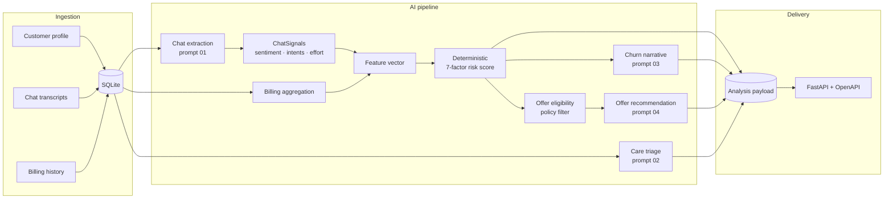

# AI Customer Retention Intelligence

[](https://github.com/adammyers1031/AI-Customer-Retention-Intelligence/actions/workflows/ci.yml)
[](pyproject.toml)
[](LICENSE)

An end-to-end Python pipeline that turns unstructured customer conversations and
billing history into governed churn-risk scores, policy-approved retention offers
and triaged care queues — exposed through a typed FastAPI service and shipped in a
non-root Docker image.

The project is deliberately built around a **separation of concerns that survives
production review**: the LLM extracts signals and writes explanations, while the
risk score and offer eligibility remain deterministic, auditable and testable.
It runs fully offline with a deterministic provider, so no API key is needed to
demo it or run the 159-test suite.

---

## What this project demonstrates

| Capability | Where it lives |
| --- | --- |
| Versioned prompt engineering with strict JSON contracts | `src/customer_intelligence/prompts/`, `llm/` |
| Automated feature extraction from chat logs + billing | `features.py` |
| Multi-factor, explainable churn risk scoring | `scoring.py` |
| Tailored, policy-governed promotional offers | `offers.py` |
| Customer-care triage with SLA routing | `care.py` |
| RESTful APIs with FastAPI, Pydantic v2 and OpenAPI | `api.py` |
| Production code standards, type hints, linting | `pyproject.toml`, `mypy`, `ruff` |
| Docker packaging and CI/CD unit testing | `Dockerfile`, `.github/workflows/ci.yml` |

---

## Architecture



Four prompts are versioned as Markdown files with `SYSTEM`/`USER` sections and
strict JSON output contracts. Every response is validated with Pydantic; a failed
contract triggers one repair attempt with the validation error appended to the
prompt. See [docs/prompts.md](docs/prompts.md).

The risk score is **computed before any narrative prompt runs**. The LLM can
explain the score but cannot change it, and offer selection can only return a code
from the deterministic eligible shortlist. See [docs/scoring.md](docs/scoring.md).

---

## Demo output

The deterministic cohort contains 12 synthetic telecom subscribers spanning the
full risk spectrum. `customer-intel seed --reset` produces:

```text
ID         NAME               PLAN          MRR  SCORE BAND      OFFER          CARE
------------------------------------------------------------------------------------
CUST-0004  Daniel Kim         business      249   63.3 critical  WINBACK_CALL   cancellation_request
CUST-0012  Ana Silva          business      189   59.0 high      SAVE20         cancellation_request
CUST-0002  Marcus Reed        standard       54   53.8 high      SAVE20         cancellation_request
CUST-0005  Sofia Alvarez      standard       49   43.3 medium    BILL_CREDIT    billing_dispute
CUST-0003  Priya Patel        premium       129   29.1 medium    FREE_TECH_CHECK technical_issue
CUST-0007  Tom Novak          standard       59   23.7 low       -              technical_issue
CUST-0006  Aisha Bello        starter        29   22.5 low       -              technical_issue
CUST-0009  Ahmed Hassan       standard       64   21.8 low       -              billing_dispute
CUST-0011  Liam O'Brien       starter        39   19.6 low       -              general_question
CUST-0001  Olivia Chen        premium        89    7.0 low       LOYALTY_UPGRADE plan_change
CUST-0008  Grace Liu          business      299    2.3 low       LOYALTY_UPGRADE plan_change
CUST-0010  Emma Wilson        premium        99    2.2 low       LOYALTY_UPGRADE plan_change

Customers: 12 | analyzed: 12 | avg risk: 29.0 | high/critical: 3 | revenue at risk: $492
Bands: {'critical': 1, 'high': 2, 'low': 7, 'medium': 2}
Offers: {'care': 1, 'retention': 4, 'upsell': 3}
```

Each customer also receives a factor-by-factor score breakdown, an agent-facing
save play, a customer-facing offer message and a care SLA. Example for `CUST-0004`:

```json
{
  "churn": {
    "score": 63.3,
    "band": "critical",
    "top_drivers": ["Payment reliability", "Support friction", "Churn language"],
    "save_play": "Same-day human outreach from the retention desk; confirm the open issue and apply an approved save offer."
  },
  "offer": {
    "code": "WINBACK_CALL",
    "offer_type": "retention",
    "expected_lift_pct": 28.3
  },
  "care": {
    "category": "cancellation_request",
    "urgency": "urgent",
    "sla_hours": 2,
    "escalate": true
  }
}
```

---

## Quickstart

Requires Python 3.10+.

```bash
git clone https://github.com/adammyers1031/AI-Customer-Retention-Intelligence.git
cd AI-Customer-Retention-Intelligence

python -m venv .venv
# Windows
.venv\Scripts\activate
# macOS / Linux
source .venv/bin/activate

pip install -r requirements-dev.txt
pip install -e .

customer-intel seed --reset
customer-intel report
customer-intel serve            # http://127.0.0.1:8000/docs
```

On Windows without an activated shell, use `.venv\Scripts\python.exe -m customer_intelligence.cli ...`.

### Docker

```bash
docker compose up --build
curl http://127.0.0.1:8000/health
```

The image runs as a non-root user, persists SQLite under the `retention-data`
volume, and exposes a container healthcheck.

---

## API

Interactive docs: `/docs` (Swagger UI) and `/redoc`.

| Method | Path | Purpose |
| --- | --- | --- |
| `GET` | `/health` | Liveness plus active LLM provider |
| `POST` | `/api/v1/customers` | Create or update a customer |
| `GET` | `/api/v1/customers` | Ranked analysed customers, filter by `risk_band` |
| `GET` | `/api/v1/customers/{id}` | Customer record |
| `POST` | `/api/v1/customers/{id}/chats` | Append a chat message |
| `GET` | `/api/v1/customers/{id}/chats` | Conversation history |
| `POST` | `/api/v1/customers/{id}/billing` | Upsert a monthly billing cycle |
| `GET` | `/api/v1/customers/{id}/billing` | Billing history |
| `POST` | `/api/v1/customers/{id}/analyze` | Run extraction, scoring, offer and care |
| `GET` | `/api/v1/customers/{id}/profile` | Latest stored analysis |
| `POST` | `/api/v1/analyze` | Analyse every stored customer |
| `GET` | `/api/v1/metrics/summary` | Fleet risk, revenue at risk, queue mix |
| `GET` | `/api/v1/offers` | Policy-approved offer catalogue |
| `GET` | `/api/v1/prompts` | Prompt version and workflow list |

Example:

```bash
curl -X POST http://127.0.0.1:8000/api/v1/customers \
  -H "Content-Type: application/json" \
  -d '{"customer_id":"CUST-1001","name":"Ada Lovelace","plan":"business","mrr":249,"tenure_months":18}'

curl -X POST http://127.0.0.1:8000/api/v1/customers/CUST-1001/chats \
  -H "Content-Type: application/json" \
  -d '{"role":"customer","message":"We are considering leaving for NovaNet."}'

curl -X POST http://127.0.0.1:8000/api/v1/customers/CUST-1001/analyze
```

Full request/response examples live in [docs/api.md](docs/api.md).

---

## LLM configuration

| Variable | Default | Meaning |
| --- | --- | --- |
| `CI_LLM_PROVIDER` | `deterministic` | `deterministic` (offline) or `openai` |
| `CI_LLM_BASE_URL` | `https://api.openai.com/v1` | OpenAI-compatible base URL |
| `CI_LLM_MODEL` | `gpt-4o-mini` | Chat-completions model |
| `CI_LLM_API_KEY` | _(empty)_ | Required only for live mode |
| `CI_DB_PATH` | `data/retention.db` | SQLite location |
| `CI_AUTO_SEED` | `1` | Seed an empty database at API startup |

```bash
export CI_LLM_PROVIDER=openai
export CI_LLM_API_KEY=sk-...
export CI_LLM_MODEL=gpt-4o-mini
customer-intel serve
```

The deterministic provider implements the same prompt → JSON → Pydantic path but
derives answers from the embedded payload. This keeps demos reproducible and tests
hermetic while the production prompts remain the real artefact.

---

## Quality gates

```bash
ruff check src tests     # style, imports, bugbear, security
mypy src                 # strict-ish typing, no untyped defs
pytest                   # 159 tests, no network, no API key
customer-intel seed --reset && customer-intel report
```

GitHub Actions runs the matrix (`3.10`, `3.12`), the pipeline smoke test, and a
Docker build + healthcheck on every push and pull request.

| Area | Coverage |
| --- | --- |
| Contracts | Forbidden extra fields, bounds, patterns, literal enums |
| Extraction | Cancellation, competitor, escalation, unresolved, windowing |
| Scoring | Weight reconciliation, bands, monotonicity, caps, narratives |
| Offers | Eligibility policy, low-risk growth-only, retention routing |
| Care | Category priority, urgency, SLA, escalation |
| Prompts | Versioning, sections, rendering errors, immutability |
| LLM | JSON repair, retry/validation loop, provider dispatch, HTTP errors |
| Storage | CRUD, foreign keys, idempotent upserts, aggregations |
| API | Status codes, 404/422 paths, seeded and empty databases |
| Pipeline | Deterministic seeding, risk spectrum, end-to-end consistency |
| CLI | Seed, report, analyze, show, error exits |

---

## Project layout

```text
.
├── src/customer_intelligence/
│   ├── api.py             # FastAPI factory and endpoints
│   ├── asgi.py            # container entrypoint
│   ├── care.py            # care triage policy
│   ├── cli.py             # seed / analyze / report / show / serve
│   ├── config.py          # environment-driven settings
│   ├── features.py        # text statistics + billing aggregation
│   ├── models.py          # Pydantic contracts
│   ├── offers.py          # catalogue, eligibility, selection
│   ├── repository.py      # SQLite persistence and metrics
│   ├── scoring.py         # weighted 7-factor churn score
│   ├── seed.py            # deterministic 12-customer cohort
│   ├── services.py        # pipeline orchestration
│   ├── llm/               # client, retry, workflows, provider
│   ├── prompts/           # versioned Markdown prompt templates
│   └── sql/schema.sql     # packaged schema
├── tests/                 # 159 hermetic tests
├── docs/                  # architecture, API, prompts, scoring
├── Dockerfile
├── docker-compose.yml
└── .github/workflows/ci.yml
```

---

## Documentation

- [Architecture](docs/architecture.md) — components, data flow, failure handling, extension points
- [API reference](docs/api.md) — endpoints, payloads, curl examples, error semantics
- [Prompt engineering](docs/prompts.md) — template structure, contracts, retry, versioning
- [Risk scoring](docs/scoring.md) — factors, formulas, bands, offer policy, worked example

---

## Data and privacy

All customers, transcripts and invoices are synthetic and generated
deterministically at seed time. No personal data is required. The live adapter
sends only the synthetic/demo payloads supplied by the API caller; in a real
deployment you should minimise PII in prompts, redact account identifiers, retain
prompt/response audits, and add tenant-level access control.

## Limitations and next steps

- Factor weights and offer lift values are illustrative, not statistically
  calibrated. A production system would fit weights on labelled churn outcomes
  and run offline evaluation before rollout.
- SQLite and synchronous endpoints keep the demo self-contained. At scale, move
  storage to PostgreSQL, queue analysis jobs, and cache prompt results.
- The deterministic provider is a test/demo double, not a model. Live quality
  depends on the configured model and should be regression-tested against a
  labelled prompt evaluation set.
- Authentication, rate limiting, observability and cost controls are intentionally
  out of scope for the portfolio build.

## License

MIT — see [LICENSE](LICENSE).
